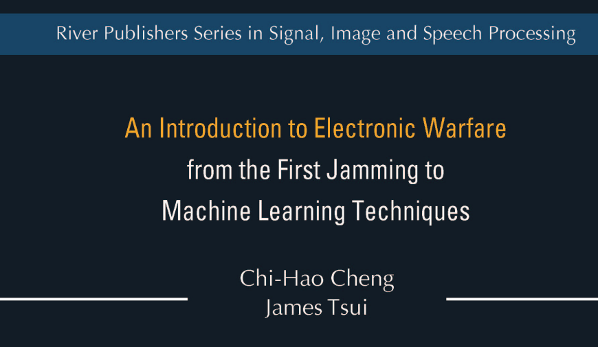
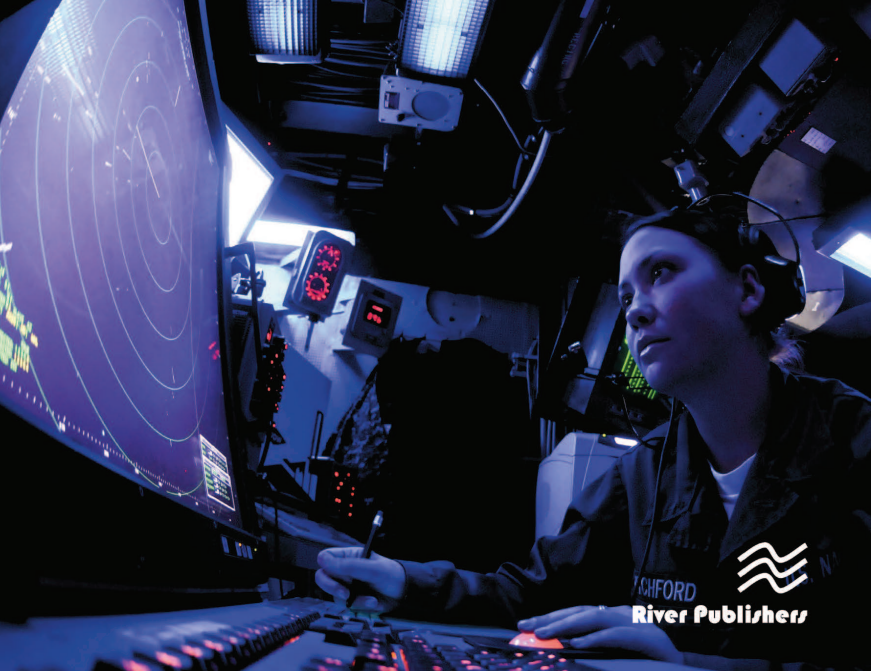
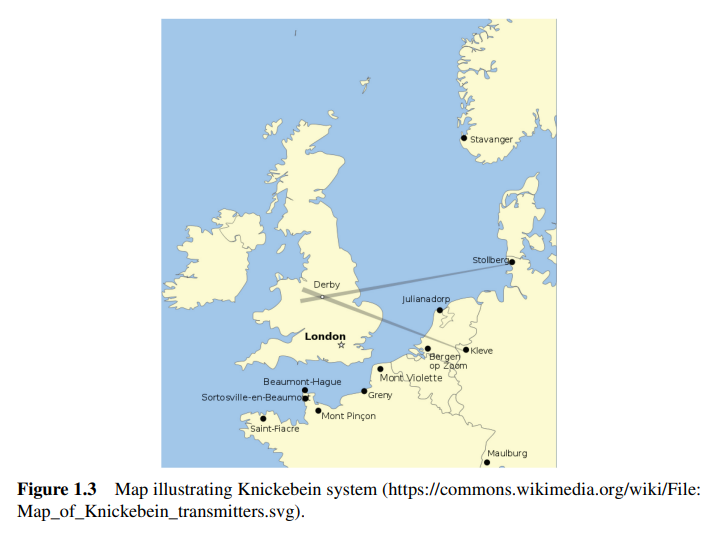
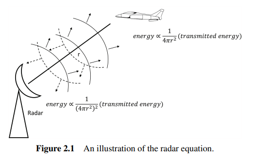
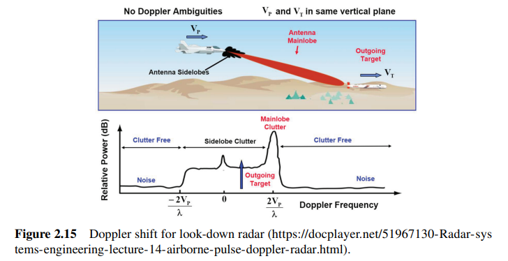
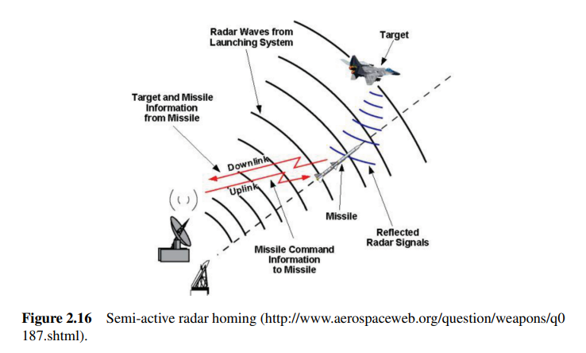
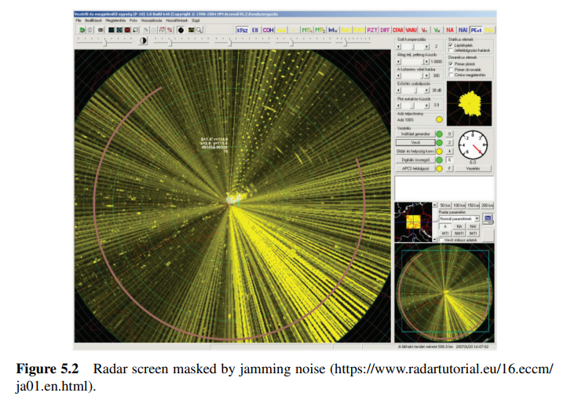

# From the Battle of World War II Flak to Machine Learning: This Electronic Warfare "Beginner's Bible" Finally Has It

From the Second World War flak to Machine Learning: The electronic warfare "bible" finally has a Chinese version. If electronic warfare is considered a field about "the invisible war", then how to present it in both professional and understandable ways is a significant challenge.
In 2021, Denmark's River Publishers published "An Introduction to Electronic Warfare: from the First Jamming to Machine Learning Techniques", quickly drawing attention to itself within the international electronic warfare community. On Amazon in the UK, readers gave the book five-star reviews: "This is an excellent book for general readers who want to understand the basics of electronic warfare (detection and countermeasures against military aircraft). Every chapter is engaging, including many real stories." Another reader noted, "It provides an excellent introduction to airborne electronic warfare. Having knowledge in communication / radar technology is helpful but not essential."
Why does this book become a "bible"? The answer lies in the two authors.
The authors: one as an instructor, and one as a world-leading author - Professor Chi-Hao Cheng. He graduated from the Control Engineering program at Zhongxing University, later obtaining his Master's and PhD degrees in Electrical and Computer Engineering from the University of Texas at Austin. He has worked in the optical communication industry for five years and currently serves as a professor in the Department of Electrical and Computer Engineering at the University of Miami. His research interests include digital signal processing, broadband receivers, and optical communications, with extensive teaching experience. Professor Cheng excels at making complex technical concepts clear and easy to understand, which is precisely what makes this book "user-friendly".
Second author, Tsui Baoyun (James Tsui, 1935-2019), has long been a household name in the domestic academic community. His numerous monographs have been translated into Chinese and have been reprinted multiple times, including "Broadband Digital Receiver Technology" and "Special Design Techniques for Digital Broadband Receivers." As a senior scientist at the Air Force Research Laboratory (AFRL), Tsui is recognized internationally as an authority on electronic warfare receiver technology, holding more than 50 invention patents and publishing over 90 academic papers. He has independently written 7 books and was selected as an AFRL Fellow and an IEEE Fellow. Internationally, his works are regarded by military electronic warfare engineers and scientists as "main references" for receiver design, as well as textbooks for graduate courses and advanced short training programs. Tsui passed away in 2019, making this book his final work in his lifelong knowledge of electronic warfare.
The rarity of this book lies in its authorship by a professor with extensive teaching experience, working alongside a world-renowned expert in electronic warfare receivers to write an introductory text that can be understood without a PhD.
This 188-page work, spanning the history of electronic warfare from its inception to the AI era, is core to its value: it weaves together a clear historical logic line, connecting the evolution of electronic warfare from its early stages to the present day through a comprehensive range of topics. The issues covered include the development of early radar technology all the way to stealth technology, low probability of interception (LPI) radar, and machine learning — covering nearly 80 years of electronic warfare's progression.
This "full spectrum" approach allows readers to establish a complete framework of knowledge about electronic warfare, rather than just understanding isolated technical points.
It is worth mentioning that this book has a unique advantage: it explains the principles of electronic warfare through historical events, helping readers understand when various technologies were developed. This is not a traditional textbook that starts with theory and then moves to application; rather, it is a "guide on an electronic warfare journey". During this journey, you unconsciously master core technical concepts. As one reader said, "All chapters are engaging, including many real stories."
The narrative style of this book is evidently beneficial: it makes it easier to understand "why there was a technology". When you know how much threat a radar-guided weapon poses in combat, you naturally understand why certain countermeasures were invented. The historical context endows the technology with a "plot", reducing the sense of dreariness.
For professionals in China, this book also has a delightful feature: it has been officially introduced by the Defense Industry Press and has been published in Chinese as "Electronic Warfare Introduction: From First Interference to Machine Learning Technology" in 2024, translated by Wang Manxi, Yao Huiwei, and Chen Dongtong. It can now be found in libraries such as Jiangsu Ocean University Library and Inner Mongolia University Library among many other universities.
Who is this book most suitable for? Based on reader feedback and the book's positioning, the following groups will benefit greatly:
1. Newcomers to electronic warfare Whether you are a new student entering the direction of electronic warfare in national defense majors, an engineer who has switched from radar or communication fields, or a tech enthusiast interested in military technology, this book is a key to quickly opening the door to electronic warfare. It assumes that the reader has basic scientific and engineering backgrounds but does not require prior knowledge of radar or electronic warfare courses, making the entry barrier friendly.
2. Cross-disciplinary technicians Today's electronic warfare is no longer an isolated discipline. Those working with radar need to understand countermeasures, those working with communications need to understand interference techniques, and those working with AI want to understand the application scenarios of signal processing. The breadth of this book precisely meets the needs for "cross-disciplinary learning" - you don't need to become an expert in each subfield, but you need to know what the whole puzzle looks like.
3. Project managers and decision-makers often determine the success or failure of a project by the choice of technical solutions in defense projects. Understanding this book can help you understand why certain technological approaches are chosen over others; why the development of electronic warfare equipment must be considered synchronously with radar development; and how machine learning technology is reshaping the future of this industry. This systematic understanding is not available from simply reading technical reports.
4. Military enthusiasts who are interested in topics such as how stealth aircraft "stealth" their presence, how missiles "deceive" their targets, and how electronic jamming "defeats" the enemy through soft power will find this book's storytelling approach to real-life battlefield cases irresistible. It is not dry formulaic compilation but a modern war history written in the language of technology.
Chapter 2 dives into the core of technology: electronic warfare receivers. The chapter arrangement of this book is also highly thought-out. Chapter 1 serves as an introduction, providing a comprehensive overview of basic concepts, classifications, and development trajectories of electronic warfare. Chapter 2 then enters the core of technology—specifically discussing electronic warfare receivers. Electronic warfare receivers are the "ears" of the entire electronic warfare system, with all forms of interference, deception, and countermeasures built on precise interception and analysis of enemy signals. James Tsui has devoted his life to this field, and this chapter not only covers key design considerations for receivers but also integrates engineering wisdom he has distilled from decades of research and development practice.
The subsequent chapters cover Fourier transform and signal processing fundamentals, radar principles and signal types, stealth technology and low detection probability radar, electronic countermeasures (ECM) and countermeasures against ECM (ECCM), and finally conclude with cutting-edge applications of machine learning in electronic warfare. The book consists of approximately 190 pages, structured compactly and logically, making it suitable for quick reading and easy topic-specific searches.
Conclusion: From the first interference to machine learning technology, electronic warfare has spanned nearly a century. During this time, technological iterations have never ceased, but some things remain constant: controlling the electromagnetic spectrum is always key to maintaining command of the battlefield.
"An Introduction to Electronic Warfare" is widely acclaimed for its perfect balance of depth and accessibility. It offers enough technical depth for professionals to read, yet it also employs sufficient narrative techniques to make it accessible to beginners. Coupled with the "technical DNA" of James Tsui, this book is not only an "entry point" but also a reference manual that can be revisited repeatedly.
In today's era where the electromagnetic spectrum has become the core battlefield of modern warfare, understanding electronic warfare is tantamount to grasping the underlying logic of future warfare. The publication of this monograph provides us with just such a key.
The Chinese version is currently available in China, and the English original can also be obtained through channels like Routledge and Amazon. Interested friends might consider picking up a copy, keeping it on their desk for easy access at any time.

## Images

<!-- PAYMENT_BLOCK -->

## Get this dataset

- Payment link (Stripe): [Buy now](https://buy.stripe.com/3cs8yP7sY87d0vu9AB)
- Payment QR code: 

<!-- /PAYMENT_BLOCK -->
